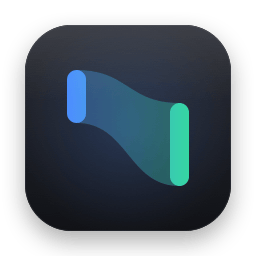
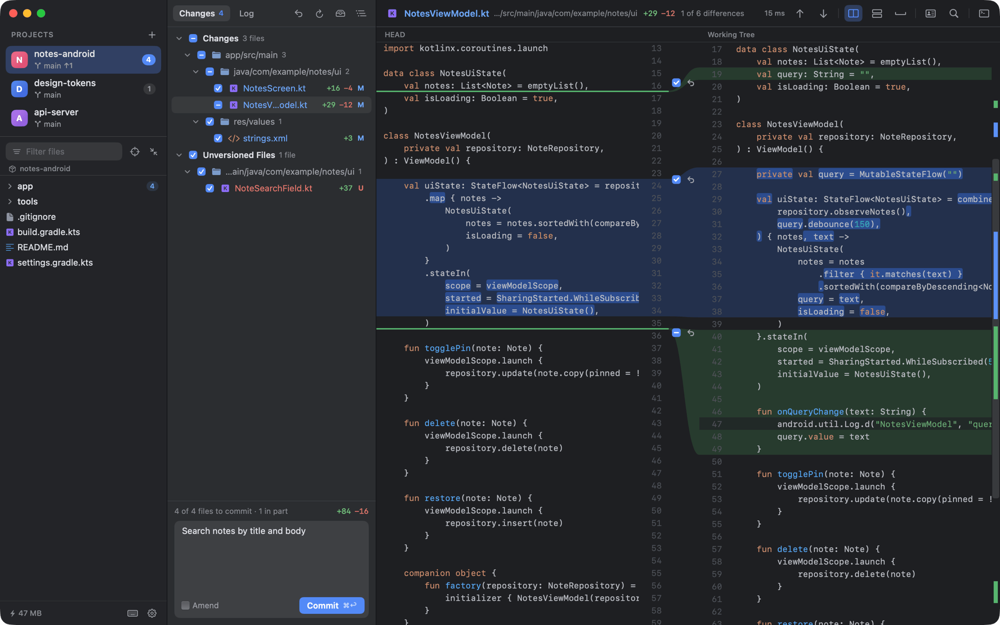
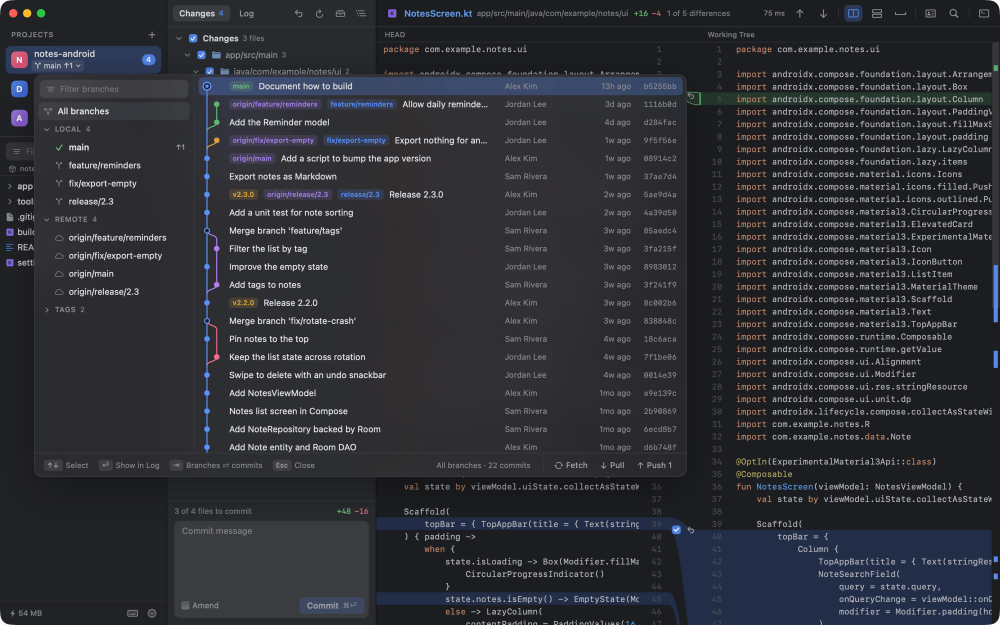
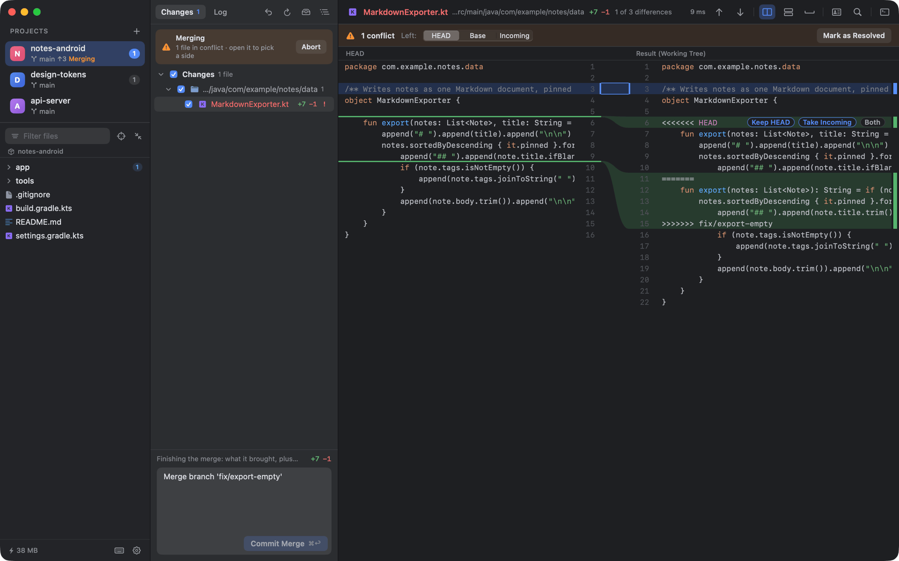
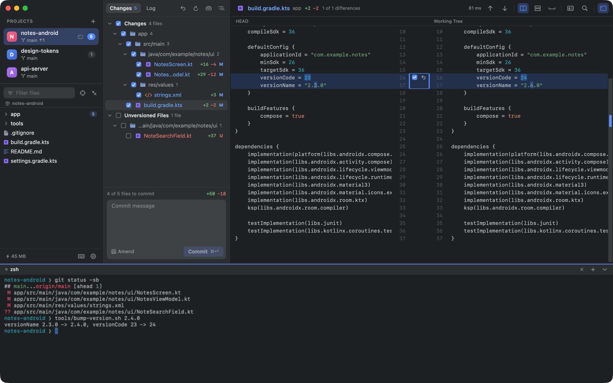
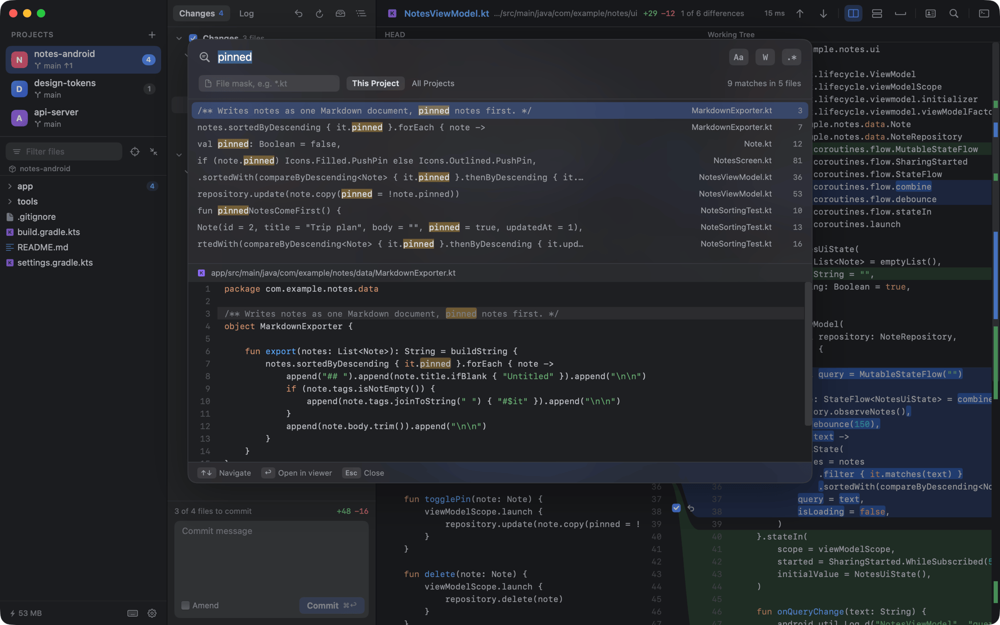
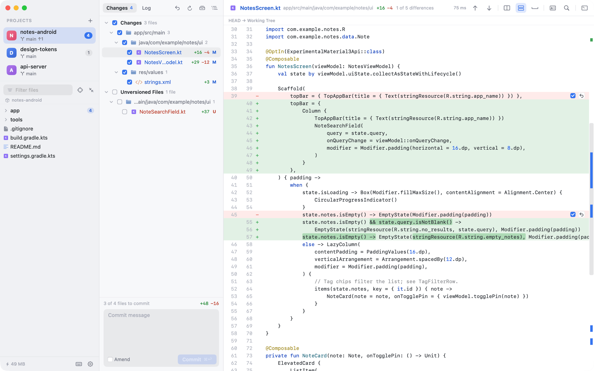
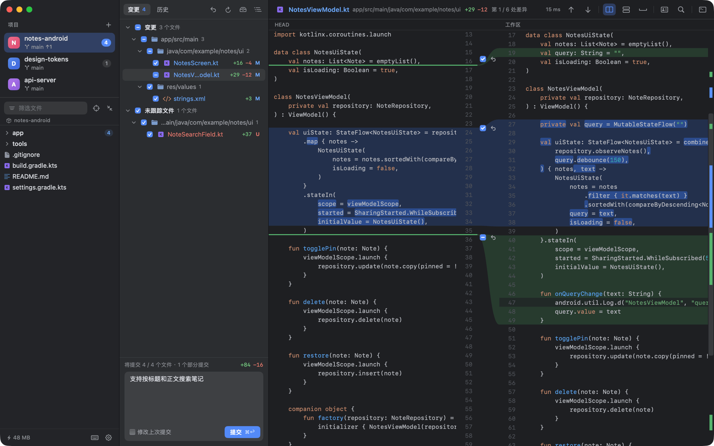

<p align="center">
  
</p>

<h1 align="center">DiffCode</h1>

<p align="center">
  <b>An IDE-grade Git diff, without the IDE.</b><br>
  A lightweight native app for Mac and Windows for reviewing what changed — yours, your teammates' or your coding agent's — and committing exactly what you mean.
</p>

<p align="center">
  <a href="LICENSE"></a>
  
  
  
  
</p>

<p align="center">
  <a href="https://ihou.github.io/DiffCode/"><b>Website</b></a> · Download for <a href="https://github.com/ihou/DiffCode/releases/latest/download/DiffCode.pkg"><b>Mac</b></a>, <a href="https://github.com/ihou/DiffCode/releases/latest/download/DiffCode-Intel.pkg"><b>Intel Mac</b></a> or <a href="https://github.com/ihou/DiffCode/releases/latest/download/DiffCode-Setup-x64.exe"><b>Windows</b></a> (4 MB)<br>
  English · <a href="README.zh-CN.md">简体中文</a>
</p>



Coding agents write more of the code now, and teammates keep pushing theirs, so more of the day goes to reading diffs. An IDE shows them well, but it brings code completion, builds, indexing and plugins along with it: a long wait and gigabytes of memory, just to see what changed. DiffCode keeps only what that job needs — a clear side-by-side diff, the Git history, precise commits and a terminal for your agent — in a native app that typically uses **30–50 MB of memory**.

- **Read-only until you act.** Refreshing, diffing and searching never write to your repository or take `index.lock`, so DiffCode can stay open next to your IDE, your terminal and your agents.
- **Fast on big files.** A 30,000-line diff with 800 changes opens in about 40 ms and scrolls at a fraction of a frame.
- **Made for the agent era.** Run Claude Code, Codex or any other CLI agent in the built-in terminal and watch its changes show up in the diff as it works. Fix a line in place, roll back one hunk, or commit only what you approve.

## Features

**A diff that is easy to read**
- Side-by-side diff with clear colours (blue changed, green added, grey deleted), curved connectors between the sides, word-level highlights and a change overview bar. `⌥⌘V` switches to a unified view.
- `F7` / `⇧F7` jump between changes and carry on into the next file.
- Edit the working-tree side directly. Changes save after a second of idle, keep the file's encoding and line endings byte for byte, and never silently overwrite an agent that is editing the same file.
- Syntax highlighting for Kotlin, Java, Swift, JavaScript/TypeScript, Python, Go, Rust, C/C++, C#, Dart, Groovy, XML, JSON, YAML, Markdown and more. Image diffs, ignore whitespace, find in file.

**Precise commits**
- Tick files, write a message, `⌘↩`. Untick single hunks — or select lines and choose *Exclude Selected Lines from Commit* — to commit only part of a file. The rest stays in your working tree.
- Amend the last commit, undo a commit you just made, *Commit and Push* with `⌥⌘K`. Git hooks run as usual, and their output is shown when they fail.
- Roll back a file or a single hunk, delete new files to the Trash — everything can be undone with `⌘Z`.

**All your repositories in one window**
- A sidebar with every project, its branch, ahead/behind counts and number of changes. Drag folders in, or run `dif ~/work/app ~/work/lib`.
- Search across projects: *Search Everywhere* (`⇧⇧`), *Go to File* with camel-case matching (`⇧⌘O`, `cvm` → `CartViewModel.kt`), and *Find in Files* (`⇧⌘F`) powered by `git grep`, with a live preview.
- A file tree designed for a narrow sidebar, a built-in terminal per project, and `⌥⌘T` to type the current file path — with the selected line range — into the terminal for your agent.

**Branches and history, when you need them**
- Click the branch name to open the Git graph: branches, tags and remotes on the left, a commit graph on the right. Check out, create, merge, rebase, rename or delete branches; fetch, pull and push. Force-push uses `--force-with-lease` and is never offered for `main` or `master`.
- Cherry-pick, revert and reset from any commit. Every one of these offers *Undo* afterwards.
- Merge conflicts get a banner with *Continue*, *Skip* and *Abort*, and *Keep HEAD*, *Take Incoming* or *Both* on every conflict.
- Stashes, blame (annotate) with commit details on hover, history of a file or of the selected lines, and *Compare with Branch* to review everything an agent did since it branched off — committed and uncommitted together.

**Everything else**
- Dark, light or system appearance. English or Simplified Chinese interface. Your choice of font for code and for the terminal (say, the Nerd Font your prompt draws its icons with), and separate font sizes for code, interface and terminal.
- A shortcut for everything. Press `⌘/` in the app to see them all.

## Screenshots

| | |
|---|---|
|  |  |
| **Git graph** — branches, tags and lanes in a dropdown that does not take a column | **Merge conflicts** — pick a side per conflict, then *Commit Merge* |
|  |  |
| **Built-in terminal** — the diff updates as soon as a script or an agent touches a file | **Find in Files** — `git grep` across one project or all of them |
|  |  |
| **Light theme, unified view** | **简体中文** — follows the system, or pick it in Settings |

The repositories in the screenshots are made up for the purpose.

## Install

### Mac

**[Download DiffCode](https://github.com/ihou/DiffCode/releases/latest/download/DiffCode.pkg)** (signed and notarized by Apple, updates itself) and open the installer. The website is at [ihou.github.io/DiffCode](https://ihou.github.io/DiffCode/).

It needs macOS 14 Sonoma or later. That download is for Macs with Apple Silicon; on an Intel Mac, download [`DiffCode-Intel.pkg`](https://github.com/ihou/DiffCode/releases/latest/download/DiffCode-Intel.pkg) instead (Apple menu → About This Mac shows which you have). To open repositories from the terminal, link the `dif` command once:

```bash
sudo ln -sf /Applications/DiffCode.app/Contents/Resources/dif /usr/local/bin/dif
dif                     # open the repository you are in
dif ~/work/app ~/work/lib
```

### Windows

**[Download the installer](https://github.com/ihou/DiffCode/releases/latest/download/DiffCode-Setup-x64.exe)** and run it. It installs for your account without administrator rights and tells you when a new version is out; prefer no installer? Unzip [`DiffCode-windows-x64.zip`](https://github.com/ihou/DiffCode/releases/latest/download/DiffCode-windows-x64.zip) and run `DiffCode.exe`. It needs 64-bit Windows 10 (1809) or Windows 11, and [Git for Windows](https://git-scm.com/download/win).

The installer is not code-signed — certificates cost money every year — so the first time you run it, SmartScreen may say *Windows protected your PC*. Choose **More info → Run anyway**. Checksums are in `SHA256SUMS-windows.txt` on the [release page](https://github.com/ihou/DiffCode/releases/latest), and GitHub Actions builds every release from the tagged source.

The Windows version is a native Win32 app written in Rust, in [`windows/`](windows/PORTING.md). It has the same features; shortcuts follow the IDE's Windows keymap (`Ctrl` where the Mac uses `⌘`), and `Ctrl+/` lists them all. The built-in terminal runs PowerShell or cmd.

### Build from source

It takes a couple of minutes:

```bash
git clone https://github.com/ihou/DiffCode.git
cd DiffCode
Scripts/build-app.sh --install   # builds DiffCode.app, copies it to /Applications, links the `dif` command
```

You need:

- A Swift toolchain: Xcode, or just the Command Line Tools (`xcode-select --install`). Tested with Swift 6.4.
- `git`, which the Command Line Tools include.

Builds from source are signed for your Mac only (ad hoc) and do not check for updates. If `/usr/local/bin` is not writable, the script prints the `sudo ln` command for the `dif` command instead.

## Keyboard shortcuts

Everything has a shortcut. A few to start with (on the Mac; on Windows press `Ctrl+/` to see them):

| Action | Shortcut | | Action | Shortcut |
|---|---|---|---|---|
| Search Everywhere | `⇧⇧` | | Next / previous change | `F7` / `⇧F7` |
| Go to File | `⇧⌘O` | | Next / previous file | `⇧⌘]` / `⇧⌘[` |
| Find in Files | `⇧⌘F` | | Side-by-side ⇄ unified | `⌥⌘V` |
| Find Action | `⇧⌘A` | | Roll back file or hunk | `⌥⌘Z` |
| Project files / Changes / Log | `⌘1` / `⌘0` / `⌘9` | | Undo roll back or delete | `⌘Z` |
| Git graph | `⌥⌘B` | | Commit message / commit | `⌘K` / `⌘↩` |
| Terminal | `⌥F12` | | Commit and push / push | `⌥⌘K` / `⇧⌘K` |
| New terminal | `⌘T` | | Type file path into terminal | `⌥⌘T` |

On a Mac keyboard, `F1`–`F12` need `Fn` unless you turn on *Use F1, F2, etc. keys as standard function keys* in System Settings; `⌃⌥⇧↓` / `⌃⌥⇧↑` also step through changes.

## Privacy and safety

- No account, no telemetry, no analytics. DiffCode talks to the network only when you fetch, pull or push (through your own `git`, credential helper and SSH agent) and, in the downloadable editions, to check for updates.
- Everything that writes — editing, rolling back, committing, checking out, history changes — happens because you asked for it. Destructive steps ask first and offer *Undo*.
- The built-in terminal runs your login shell (PowerShell or cmd on Windows) with your own privileges, exactly like Terminal.app. Programs you start there, including coding agents, can do whatever your account can.

## How it stays light

There is no index, no background process and no language server. Git does the heavy lifting (`git diff --no-index --diff-algorithm=histogram`, `git grep`, `git ls-files`). The diff is rasterized once into small tiles that Core Animation moves around while you scroll, so a frame costs a few layer moves rather than a redraw. The terminal reads into one reused buffer and slows down a program that floods it instead of piling output up in memory. Measurements are in the [user guide](docs/GUIDE.zh-CN.md#实测) (Chinese).

## Not planned

There is no Linux version. Editing is plain text in place — no code completion, multiple cursors or find-and-replace. Interactive rebase, tag management and submodules are left to `git` in the built-in terminal. DiffCode never opens an external editor.

## Documentation

- [User guide (简体中文)](docs/GUIDE.zh-CN.md) — every feature in detail, plus measurements and the code layout.
- [Windows port](windows/PORTING.md) — how the Windows version is built, tested and released.
- Building the release editions: [`release/macos`](release/macos/README.md) (notarized download with Sparkle) and [`release/appstore`](release/appstore/README.md) (sandboxed Mac App Store edition, not published).

## Contributing

Bug reports, ideas and pull requests are welcome — see [CONTRIBUTING.md](CONTRIBUTING.md). Run `swift test` (or `cargo test --workspace` in `windows/`) before sending a change; the suite drives real temporary repositories end to end. Please report security issues privately as described in [SECURITY.md](SECURITY.md).

## License

DiffCode is free software under the [GNU General Public License v3.0](LICENSE). Copyright © 2026 the DiffCode authors.

It uses [SwiftTerm](https://github.com/migueldeicaza/SwiftTerm) for the terminal and, in the downloadable edition, [Sparkle](https://sparkle-project.org) for updates, both under the MIT license; their notices ship inside the app (*About DiffCode*). The Windows version builds on Rust crates such as [alacritty_terminal](https://github.com/alacritty/alacritty) and [windows-rs](https://github.com/microsoft/windows-rs); `THIRD-PARTY-NOTICES.txt` beside the program lists them all with their licenses.

The GPL covers the code, not the DiffCode name or icon. If you distribute a modified version, please give it a different name and icon so people can tell the two apart.
