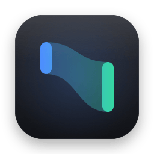
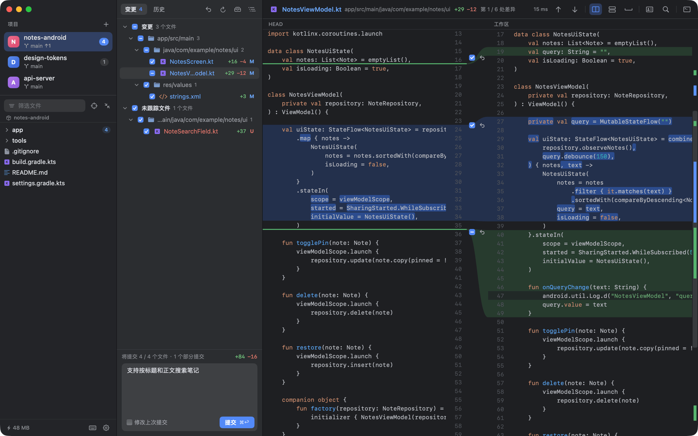
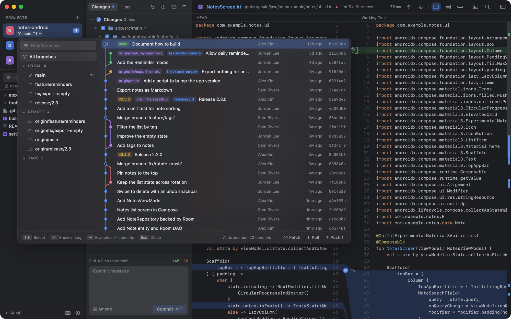
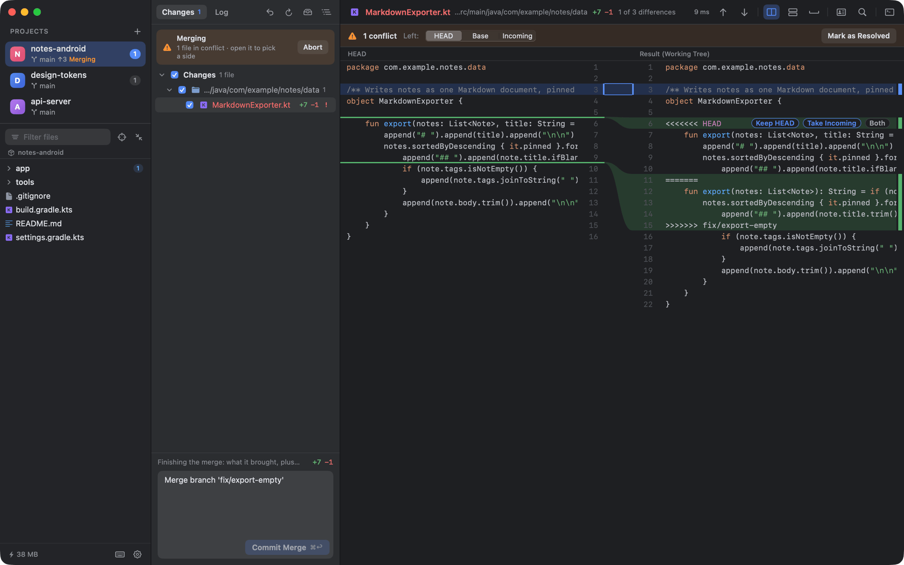
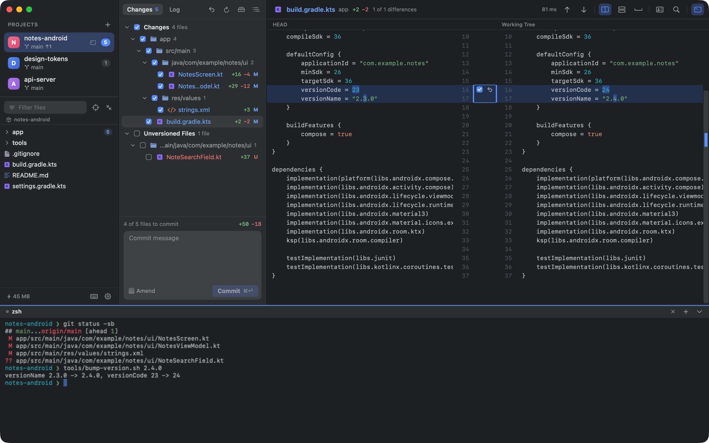
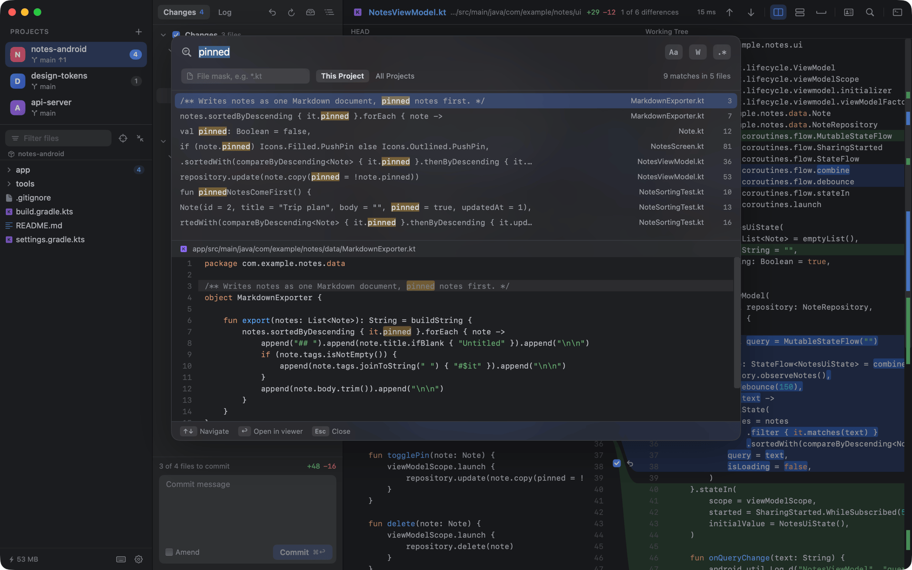
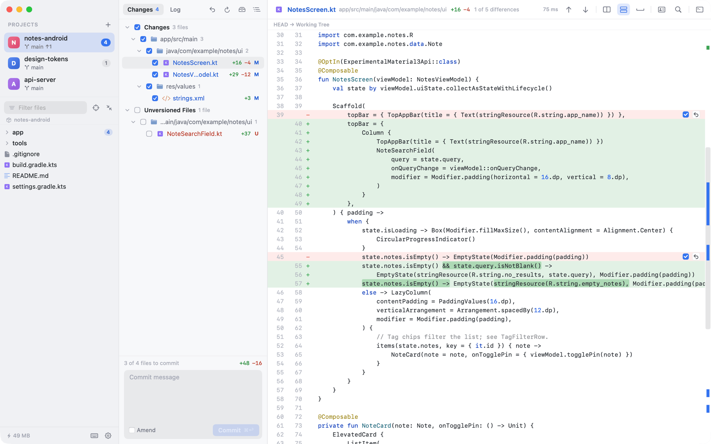
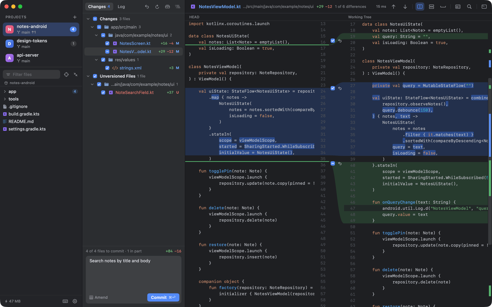

<p align="center">
  
</p>

<h1 align="center">DiffCode</h1>

<p align="center">
  <b>像 IDE 一样好用的 Git diff，不用打开 IDE。</b><br>
  一个轻量的原生 Mac 应用：看清改了什么——你自己的、同事的，或者 coding agent 的——只提交你想提交的。
</p>

<p align="center">
  <a href="LICENSE"></a>
  
  
  
</p>

<p align="center">
  <a href="README.md">English</a> · 简体中文
</p>



AI 写的代码越来越多，同事也在不停地推提交，每天花在看 diff 上的时间越来越长。IDE 当然能把改动看得很清楚，可它同时带着代码补全、编译、索引和一堆插件：打开要等，还要占掉几个 GB 内存，就为了看一眼改了什么。DiffCode 只留下看改动需要的核心功能：清楚的并排 diff、Git 树和历史、精确到行的提交，再加一个给 agent 用的终端。原生应用，平时只占 **30–50 MB 内存**。

- **平时只读。** 刷新、diff、搜索都不写仓库，也不占 `index.lock`，可以和 IDE、命令行、agent 同时开着。
- **大文件也快。** 3 万行、800 多处变更的 diff 约 40 ms 打开，滚动一帧的开销远低于刷新间隔。
- **为 agent 时代设计。** 在内置终端里跑 Claude Code、Codex 或任何命令行 agent，它改的东西实时出现在上方的 diff 里。哪行不对直接改，哪处不要单独回滚，满意的部分才提交。

## 功能

**好读的 diff**
- 并排 diff，配色清楚（蓝 = 修改，绿 = 新增，灰 = 删除），曲线连接带、词级高亮、变更总览条；`⌥⌘V` 切换为单栏视图。
- `F7` / `⇧F7` 在改动之间跳转，到文件末尾自动进入下一个文件。
- 工作区那一侧可以直接打字：停手约 1 秒自动保存，编码和换行符逐字节保持原样；agent 同时在改这个文件也不会被悄悄覆盖。
- 语法高亮覆盖 Kotlin、Java、Swift、JS/TS、Python、Go、Rust、C/C++、C#、Dart、Groovy、XML、JSON、YAML、Markdown 等；图片对比、忽略空白、文件内查找。

**精确到行的提交**
- 勾选文件、写提交说明、`⌘↩`。在 diff 里取消勾选某几处改动，或者选中几行右键「不提交选中的行」，就只提交其余部分，没提交的留在工作区。
- 修改上次提交（Amend）、撤销刚才的提交、`⌥⌘K` 提交并推送；Git 钩子照常运行，失败时显示原始输出。
- 回滚整个文件或单处改动、把新文件移到废纸篓，都能 `⌘Z` 撤销。

**所有仓库在一个窗口里**
- 侧边栏列出所有项目，带分支、领先 / 落后数和变更数；把文件夹拖进来，或者 `dif ~/work/app ~/work/lib`。
- 跨项目搜索：随处搜索（`⇧⇧`）、驼峰模糊匹配的查找文件（`⇧⌘O`，`cvm` → `CartViewModel.kt`）、基于 `git grep` 的在文件中查找（`⇧⌘F`，带预览）。
- 为窄栏设计的文件树、每个项目自己的终端；`⌥⌘T` 把当前文件路径（连同选中的行号）输入终端，直接指给 agent 看。

**分支和历史，需要时都在**
- 点分支名打开 Git 树：左边分支、标签、远程，右边提交图。检出、新建、合并、变基、重命名、删除分支；获取、拉取、推送。强制推送用 `--force-with-lease`，main / master 不提供。
- 在任意提交上拣选（Cherry-pick）、还原（Revert）、重置（Reset），做完都能撤销。
- 合并冲突有横幅（继续 / 跳过 / 中止），每处冲突上有「保留 HEAD」「采用传入」「两者都要」。
- Stash 列表、逐行追溯（Blame，悬停看提交详情）、文件和选中几行的历史，以及「与分支比较」：一次看完 agent 自分叉以来的全部改动，已提交的和没提交的都在。

**其他**
- 深色 / 浅色 / 跟随系统；界面语言 跟随系统 / English / 简体中文；代码、界面、终端字号分别可调。
- 所有操作都有快捷键，应用内按 `⌘/` 查看全部。

## 截图

| | |
|---|---|
|  |  |
| **Git 树**——分支、标签和提交图在下拉框里，不额外占一栏 | **合并冲突**——每处冲突选一边，然后提交合并 |
|  |  |
| **内置终端**——脚本或 agent 一改文件，diff 立刻更新 | **在文件中查找**——`git grep`，可以跨所有项目 |
|  |  |
| **浅色主题、单栏视图** | **English**——跟随系统，或在设置里选 |

截图里的仓库都是为演示虚构的。

## 安装

**[下载 DiffCode](https://github.com/ihou/DiffCode/releases/latest/download/DiffCode.pkg)**（经过 Apple 签名和公证，会自动更新），打开安装包按提示安装即可。官网：[ihou.github.io/DiffCode](https://ihou.github.io/DiffCode/zh/)。

需要 macOS 14 Sonoma 及以上、Apple Silicon 的 Mac（Intel 未测试）。想在终端里打开仓库，先链接一次 `dif` 命令：

```bash
sudo ln -sf /Applications/DiffCode.app/Contents/Resources/dif /usr/local/bin/dif
dif                     # 打开当前目录所在的仓库
dif ~/work/app ~/work/lib
```

### 从源码构建

大约几分钟：

```bash
git clone https://github.com/ihou/DiffCode.git
cd DiffCode
Scripts/build-app.sh --install   # 构建 DiffCode.app，复制到 /Applications，并链接 dif 命令
```

需要：

- Swift 工具链：Xcode，或者只装命令行工具（`xcode-select --install`）。已在 Swift 6.4 上测试。
- `git`（命令行工具里自带）。

源码构建的应用只给本机签名（ad-hoc），不检查更新。`/usr/local/bin` 不可写时，脚本会打印链接 `dif` 命令要用的 `sudo ln` 命令。

## 隐私与安全

- 没有账号、没有遥测、没有统计。只有你获取、拉取、推送时（通过你自己的 `git`、凭据助手和 SSH agent），以及公证版检查更新时才会联网。
- 所有会写入的操作——编辑、回滚、提交、检出、改写历史——都由你主动触发；危险的操作先确认，做完能撤销。
- 内置终端运行的是你的登录 shell，权限和你在 Terminal.app 里一样；在里面启动的程序（包括 coding agent）能做你的账号能做的一切。

## 文档

- [使用说明](docs/GUIDE.zh-CN.md)：每个功能的细节、全部快捷键、实测数据和代码结构。
- 发布渠道的构建：[`release/macos`](release/macos/README.md)（公证版，Sparkle 自动更新）和 [`release/appstore`](release/appstore/README.md)（沙盒化的 App Store 版，未上架）。

## 参与

欢迎反馈问题、提建议和提交 PR，见 [CONTRIBUTING.md](CONTRIBUTING.md)。提交改动前请先跑 `swift test`，测试会在真实的临时仓库上端到端运行。安全问题请按 [SECURITY.md](SECURITY.md) 私下报告。

## 许可证

DiffCode 是自由软件，采用 [GNU 通用公共许可证 v3.0](LICENSE)。Copyright © 2026 the DiffCode authors.

终端用的是 [SwiftTerm](https://github.com/migueldeicaza/SwiftTerm)，下载版的自动更新用的是 [Sparkle](https://sparkle-project.org)，二者都是 MIT 许可证，许可声明随应用分发（「关于 DiffCode」）。

GPL 授权的是代码，不包括 DiffCode 这个名字和图标。如果你分发修改后的版本，请换一个名字和图标，方便大家区分。
